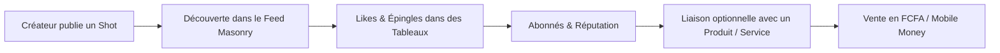

# Baobart — Le studio partagé de l'Afrique créative

> **Plateforme tout-en-un de création, découverte, partage et monétisation pour les créateurs africains.**  
> Du premier croquis au premier encaissement en monnaie locale (FCFA, Mobile Money).

[](package.json)
[](https://nextjs.org/)
[](tsconfig.json)
[](prisma/schema.prisma)
[](app/globals.css)

---

## 📌 Sommaire

1. [C'est quoi Baobart ?](#-cest-quoi-baobart-)
2. [À quoi sert la plateforme ?](#-à-quoi-sert-la-plateforme-)
3. [Le concept & la boucle centrale](#-le-concept--la-boucle-centrale)
4. [Baobart Shield & Protection des filigranes](#-baobart-shield--protection-des-filigranes)
5. [Démarrage rapide](#-démarrage-rapide)
6. [Commandes utiles](#-commandes-utiles)
7. [Structure du projet](#-structure-du-projet)
8. [Les quatre règles techniques inviolables](#-les-quatre-règles-techniques-inviolables)
9. [Documentation de référence](#-documentation-de-référence)

---

## 🌍 C'est quoi Baobart ?

**Baobart** est une place de marché communautaire pensée pour les créatifs d'Afrique (designers, illustrateurs, typographes, photographes, artistes 3D, artisans, créateurs de contenu).

La plateforme fusionne le meilleur de trois géants mondiaux :
- **Dribbble** : pour les portfolios, les « shots » (publications visuelles), les likes, les abonnements et la reconnaissance par les pairs ;
- **Pinterest** : pour le feed visuel infini en grille dynamique (*masonry*), les tableaux d'inspiration et l'épinglage (*saves*) ;
- **Gumroad** : pour la vente directe de ressources numériques (mockups, polices de caractères, templates, packs 3D) et physiques, ainsi que la prestation de services/commissions.

### La promesse fondamentale
> **« Du vrai matériel local, pas de banque d'images générique. »**  
> Des textures wax authentiques, des photographies de Dakar à Abidjan, des typographies inspirées d'alphabets locaux, des modèles adaptés aux marques et agences du continent.

---

## 🎯 À quoi sert la plateforme ?

### Le problème constaté
1. **Monétisation inaccessible** : les créateurs africains sont exclus des grandes plateformes internationales (Stripe indisponible, comptes PayPal restreints, devises inadaptées).
2. **Pillage et vol d'œuvres** : les créations partagées sur les réseaux sociaux sont aspirées sans rémunération, et de plus en plus utilisées pour entraîner des modèles d'IA sans consentement.
3. **Pénurie d'actifs graphiques locaux** : les agences et entreprises africaines doivent se rabattre sur des banques d'images occidentales déconnectées des réalités du continent.

### La solution Baobart
- **Encaissement en monnaie locale** : prise en charge native du **FCFA (XOF)** et des portefeuilles mobiles (**Wave, Orange Money, MTN MoMo**) ainsi que des cartes via Flutterwave et Paystack.
- **Protection native avec Baobart Shield** : protection multicouche des créations contre le vol et le moissonnage IA.
- **Visibilité et communauté** : système de badges au mérite (Créateur vérifié, Top créateur, VIP — *non achetables*), concours, forum et job board.

---

## 🔄 Le concept : la boucle centrale



Tout contenu visuel partagé sur Baobart peut être une simple inspiration ou se transformer en ressource téléchargeable payante.

---

## 🛡️ Baobart Shield & Protection des filigranes

Le **Baobart Shield** (`Doc/SPEC_BAOBART_SHIELD.md`) est le système de défense en profondeur conçu pour protéger la propriété intellectuelle des créateurs.

### Les 4 couches du Shield

| Couche | Objectif | Statut |
|---|---|---|
| **1 — Provenance** | Filigrane invisible, manifestes cryptographiques C2PA, empreinte perceptuelle pHash | Prévu (M6) |
| **2 — Aperçus dégradés & Filigranes** | Filigrane visible diagonal, réduction de résolution, métadonnées XMP anti-IA | **Actif & Déployé (v1.86+)** |
| **3 — Perturbation anti-IA** | Bruitage de style imperceptible (Glaze / Nightshade) sur GPU | Prévu (M6) |
| **4 — Juridique & Veille** | Procédure de retrait DMCA, veille automatisée sur les copies | Prévu (M7) |

---

### 🔍 Comment sont générés et affichés les filigranes (Couche 2) ?

Le filigrane Baobart n'est **jamais** un simple calque CSS qui pourrait être masqué par l'inspecteur du navigateur : il est **fusionné directement dans les pixels de l'image côté serveur** grâce à la bibliothèque de traitement d'image `sharp`.

#### 1. Rendu et composition du filigrane (`lib/upload/filigrane.ts`)
- **Police embarquée** : rendu avec [`assets/polices/Inter-Bold.otf`](assets/polices/Inter-Bold.otf) (licence OFL), présente dans le conteneur pour éviter tout problème d'absence de polices sous Linux/Alpine.
- **Texte dynamique** : `@<pseudo> · Baobart` (ou simplement `Baobart` si aucun pseudo n'est renseigné).
- **Lisibilité tout-terrain** : texte blanc superposé sur une ombre noire portée avec un décalage calculé, lisible aussi bien sur un fond sombre que sur un fond blanc.
- **Motif diagonal** : incliné à `-30°`, opacité calibrée à `32 %` (`0.32`), répété en tuiles sur toute la surface de l'image.
- **Protection XMP** (`lib/upload/apercu.ts`) : insertion du standard IPTC `plus:DataMining = DMI-PROHIBITED-EXCEPTSEARCHENGINEINDEXING` pour interdire l'entraînement IA tout en préservant le référencement.

#### 2. Deux formats d'aperçus publics (`lib/upload/vignette.ts`)
L'original haute définition est **strictement privé** sur le stockage objet (S3 / MinIO) et accessible uniquement après achat via des URLs signées temporaires (`signed_url_helper`).  
Pour le public, deux versions filigranées sont générées :
1. **L'aperçu de détail (800 px)** : `public/apercus/<mediaId>-v3.webp` (qualité 60 WebP), enregistré en base dans le champ `coverUrl`.
2. **La vignette du fil (400 px)** : `public/apercus/<mediaId>-v3-400.webp` (qualité 65 WebP), déduite par convention d'URL sans alourdir la base de données via la fonction `vignetteDe(coverUrl)`.

#### 3. Affichage dans l'interface utilisateur
- **Dans le Feed (`components/feed/resource-card.tsx`)** :  
  L'image de la carte appelle `vignetteDe(r.coverUrl)` pour charger la vignette 400 px, avec un `srcset` vers l'aperçu 800 px pour les écrans haute densité.
- **Sur la fiche produit (`components/product/detail.tsx`)** :  
  Le visuel principal affiche directement `produit.coverUrl` (800 px filigrané). Les vignettes secondaires d'aperçus appellent `vignetteDe(a.coverUrl)`.
- **Sur le profil créateur (`components/createurs/carte-ressource.tsx`)** :  
  Utilisation optimisée de la vignette via `vignetteDe(ressource.coverUrl)`.

#### 4. Comment afficher / tester / régénérer les filigranes ?

- **Lors de l'upload d'un produit** :  
  Tout téléversement d'image dans le tableau de bord déclenche automatiquement `produireApercu` (`lib/upload/service.ts`). L'image affichée dans la boutique comportera immédiatement le filigrane diagonal avec le pseudo du créateur.
- **Régénération par script (en cas de mise à jour de la recette)** :
  ```bash
  # Mode simulation : liste les aperçus périmés sans toucher au stockage
  pnpm apercus:regenerer

  # Mode application : régénère et applique les filigranes sur S3/MinIO
  pnpm apercus:regenerer -- --appliquer
  ```

---

## 🚀 Démarrage rapide

### Prérequis
- **Node.js 22+**
- **pnpm 10+**
- **Docker & Docker Compose**

### Installation

```bash
# 1. Cloner et installer les dépendances
pnpm install

# 2. Configurer les variables d'environnement
cp .env.example .env

# 3. Lancer les services d'infrastructure (PostgreSQL, Redis, MinIO)
pnpm stack:up        # ou docker compose up -d

# 4. Appliquer les migrations de la base de données
pnpm db:migrate

# 5. Injecter les données de base (plans, licences, badges)
pnpm db:seed

# 6. Préparer la base de test isolée (port 5433, base baobart_test)
pnpm db:test:setup

# 7. (Optionnel) Charger les comptes et données de démonstration
pnpm db:seed:demo
pnpm comptes:test

# 8. Démarrer le serveur de développement
pnpm dev             # Disponible sur http://localhost:3100
```

---

## 🛠 Commandes utiles

| Commande | Description |
|---|---|
| `pnpm dev` | Démarre le serveur Next.js en local (port 3100) |
| `pnpm build` | Compile le projet pour la production |
| `pnpm start` | Démarre l'application compilée |
| `pnpm typecheck` | Vérifie les types TypeScript en mode strict |
| `pnpm lint` | Lance la vérification ESLint |
| `pnpm test` | Exécute tous les tests Vitest (unitaires + intégration) |
| `pnpm test:unite` | Exécute uniquement les tests purs (sans base de données) |
| `pnpm test:e2e` | Lance les tests Playwright (port 3200, base `baobart_e2e`) |
| `pnpm db:migrate` | Applique les migrations Prisma en développement |
| `pnpm db:deploy` | Déploie les migrations (utilisé en production / CI) |
| `pnpm db:studio` | Ouvre l'interface Prisma Studio |
| `pnpm db:seed` | Remplit la base avec les données socles |
| `pnpm db:test:setup` | Recrée la base `baobart_test` et applique les migrations |
| `pnpm apercus:regenerer` | Détecte et met à jour les filigranes d'aperçus (`-- --appliquer` pour exécuter) |
| `pnpm stack:up` / `stack:down` | Démarre ou arrête la stack Docker (Postgres, Redis, MinIO) |

---

## 📁 Structure du projet

```
baobart/
├── app/                  # Routes et pages Next.js (App Router)
│   ├── (vitrine)/        # Accueil, explore, createurs, products, blog, etc.
│   ├── dashboard/        # Espaces créateurs, acheteurs et administration
│   ├── api/              # Routes d'API (cron, webhooks de paiement, uploads, health)
│   └── globals.css       # Tokens du design system « Sticker » et styles globaux
├── components/           # Composants d'interface classés par domaine
│   ├── feed/             # Cartes de ressources, grille masonry
│   ├── product/          # Fiches produits, prévisualisations
│   ├── createurs/        # Éléments de profil et vitrines créateurs
│   └── anime/            # Micro-animations validées
├── lib/                  # Logique métier et domaine
│   ├── upload/           # Fabrique d'aperçus, filigrane.ts, vignette.ts, stockage S3
│   ├── payments/         # Encaissement (Paystack, Flutterwave), grand livre
│   ├── auth/             # Authentification sur mesure, sessions, passkeys, 2FA
│   ├── securite/         # Limites de débit Redis, détection anti-bot
│   └── i18n/             # Monnaie et formatage en FCFA
├── assets/polices/       # Police Inter-Bold utilisée pour graver les filigranes
├── prisma/               # schema.prisma, migrations SQL, jeux de données (seed)
├── Doc/                  # Documentation produit complète et spécifications d'architecture
└── scripts/              # Scripts de maintenance, régénération des aperçus, tests
```

---

## ⚖️ Les quatre règles techniques inviolables

1. **L'argent est un entier** :  
   Tout montant est stocké dans son unité mineure ISO 4217. Le XOF n'ayant pas de centime, 1 FCFA = 1 unité mineure. Aucun nombre flottant ne manipule d'argent (`lib/i18n/money.ts`).
2. **Pagination par curseur obligatoire** :  
   Jamais d'`OFFSET` SQL sur les tables du feed à fort volume ; pagination stricte par curseur (`createdAt` / `id`) et compteurs dénormalisés.
3. **Le Sticker System est un système, pas une palette** :  
   Bordures noires marquées, ombres portées nettes à 45°, deux accents colorés maximum par écran, jaune réservé aux fonds (jamais en texte), orange de texte normalisé à `#B34A1F` (`Doc/ANALYSE_DESIGN_SYSTEM_BAOBART.md`).
4. **Le grand livre est immuable et les soldes sont figés** :  
   La table `BalanceTransaction` n'accepte ni `UPDATE` ni `DELETE` (verrouillée par triggers PostgreSQL). Toute correction passe par une écriture comptable d'inversion.

---

## 📚 Documentation de référence

Pour approfondir la vision et les spécifications d'ingénierie, consultez le dossier [`Doc/`](Doc/) :
- **[Plan de refonte & vision](Doc/PLAN_REFONTE_BAOBART_GUMROAD.md)** : document fondateur, modèle économique, roadmap M0→M8.
- **[Spécification Baobart Shield](Doc/SPEC_BAOBART_SHIELD.md)** : détail des 4 couches de protection intellectuelle.
- **[Matrice d'implémentation](Doc/MATRICE_IMPLEMENTATION.md)** : état d'avancement exact du code fonctionnalité par fonctionnalité.
- **[Spécification du déploiement](Doc/SPEC_DEPLOIEMENT_SELFHOSTING_BAOBART.md)** : Docker, Vercel, VPS et scalabilité.

---

<p align="center">
  <strong>Baobart</strong> · Fait avec passion pour les créatifs d'Afrique.
</p>
